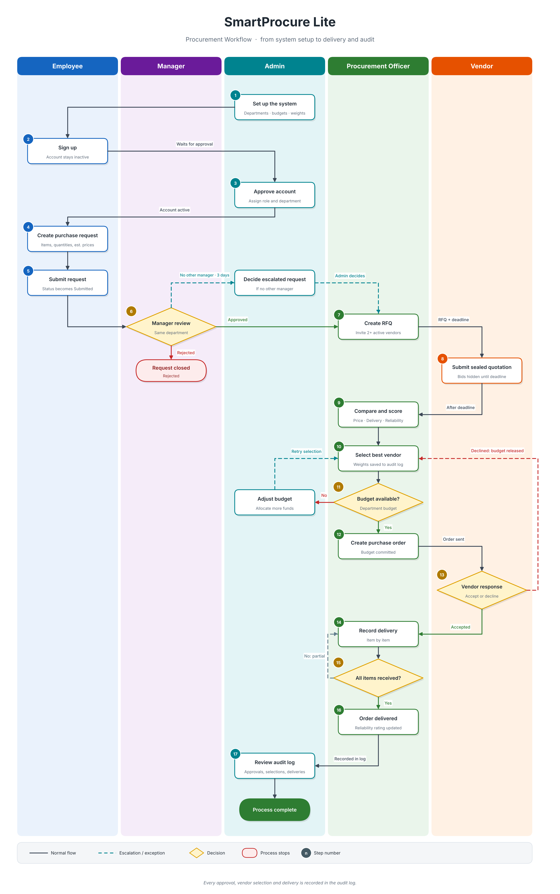

# SmartProcure Lite

**Purchasing & Vendor Evaluation System**

A role-based web application that digitises the complete procurement lifecycle of an organisation — from an employee's purchase request, through departmental approval and sealed-bid vendor quotations, to purchase orders, goods receipt and vendor performance tracking — with budget control and a full audit trail built in.


---

## Table of Contents

1. [Overview](#overview)
2. [Key Features](#key-features)
3. [User Roles](#user-roles)
4. [Procurement Workflow](#procurement-workflow)
5. [Vendor Evaluation Model](#vendor-evaluation-model)
6. [Technology Stack](#technology-stack)
7. [Project Structure](#project-structure)
8. [Database Design](#database-design)
9. [Security](#security)
10. [Installation](#installation)
11. [Configuration](#configuration)
12. [Testing](#testing)
13. [Roadmap](#roadmap)
14. [Author](#author)

---

## Overview

Many small and mid-sized organisations still manage purchasing through email threads and spreadsheets. This leads to unapproved spending, no price comparison, no record of who decided what, and no objective way to judge suppliers.

**SmartProcure Lite** replaces that with a single, structured system where:

- every purchase starts as a **request** that must be approved by the right manager,
- spending is checked against a **departmental budget** before an order is placed,
- vendors compete through **sealed-bid RFQs**, and the winning quotation is chosen with a **transparent, weighted scoring formula**,
- every important action is written to an **append-only audit log**.

The application is written in plain PHP (no framework) with a clean separation between pages, business rules and shared infrastructure, which makes it easy to read, test and extend.

---

## Key Features

### Purchasing workflow
- **Purchase requests** with multiple line items, estimated prices and a "needed by" date; Draft → Submitted → Approved / Rejected / Cancelled lifecycle.
- **Manager approvals** limited to managers of the same department (a requester can never approve their own request).
- **Admin escalation** when a department has no other active manager and the request has waited beyond a configurable number of days.
- **Departmental budgets** per period (yearly or monthly); funds are committed when an order is created and released if the vendor declines or the order is cancelled.

### Sourcing and vendor selection
- **RFQ (Request for Quotation)** — the procurement officer invites a minimum number of active vendors with a deadline.
- **Sealed bids** — before the deadline, no one (not even the officer) can see quoted prices, and vendors never see each other.
- **Independent, explainable scoring** of every quotation on price, delivery and reliability, with admin-configurable weights.
- **Reliability rating (1–5)** calculated automatically from each vendor's on-time delivery history, with a documented manual override that requires a written reason.

### Fulfilment
- **Purchase orders** with a vendor acknowledgement step (Accept / Decline).
- **Partial and complete deliveries** per item, with over-receiving blocked by the server.
- **Vendor portal** — suppliers log in to see only their own RFQs and orders, submit quotations and respond to orders.

### Administration and visibility
- **User management** — signup requires admin approval; roles, departments and vendor links managed by the admin.
- **Department, budget and vendor management.**
- **Audit logs** for logins, decisions, vendor selections (including the weights and formula version used) and more.
- **In-app notifications** for each stage of the process.
- **Role-specific dashboards** with Chart.js charts.
- **Admin settings page** for scoring weights.

---

## User Roles

| Role | Description | Main capabilities |
|---|---|---|
| **Employee / Requester** | Staff member who needs goods or services | Create, edit, submit and cancel own purchase requests |
| **Manager / Approver** | Department head | Approve or reject requests of their own department |
| **Procurement Officer** | Handles sourcing | Create RFQs, compare quotations, select a vendor, raise purchase orders, record deliveries, manage vendors |
| **Administrator** | System owner | Manage users, departments, budgets, settings; view audit logs; decide escalated approvals |
| **Vendor** | External supplier | Respond to own RFQs, accept or decline own orders |

Access is enforced on the server for every page and action (role checks, ownership checks and account-status checks), not just by hiding menu items.

---

## Procurement Workflow

The diagram shows the complete lifecycle, from system setup to delivery and audit, with one lane per role: **Employee**, **Manager**, **Admin**, **Procurement Officer** and **Vendor**.

<p align="center">
  <a href="docs/procurement-workflow.png">
    
  </a>
</p>

*Click the image to view it in full size.*

### Step-by-step summary

| # | Step | Actor | Result |
|---|---|---|---|
| 1 | Set up departments, budgets, vendors and scoring weights | Admin | System ready for use |
| 2-3 | Sign up, then approve the account and assign a role | Employee, Admin | Account becomes active |
| 4-5 | Create and submit a purchase request | Employee | Request becomes *Submitted* |
| 6 | Review the request | Manager | *Approved* or *Rejected*, recorded permanently |
| 6a | Decide an escalated request (no other manager for 3 days) | Admin | Request continues to sourcing |
| 7 | Create an RFQ and invite vendors | Procurement Officer | RFQ is *Open* until the deadline |
| 8 | Submit a quotation for every requested item | Vendor | Bid stays sealed until the deadline |
| 9 | Compare and score eligible quotations | Procurement Officer | Ranked by weighted score |
| 10 | Select the winning vendor | Procurement Officer | RFQ becomes *Awarded*; decision audited |
| 11 | Check the departmental budget | Procurement Officer | Order allowed, or blocked |
| 11a | Adjust the budget if funds are short | Admin | Officer can retry the selection |
| 12 | Create the purchase order | Procurement Officer | Order is *Created*; budget is committed |
| 13 | Accept or decline the order | Vendor | *Accepted*, or *Declined* with budget released |
| 14-15 | Record goods received, item by item | Procurement Officer | *Partially Delivered* until everything arrives |
| 16 | Close the order and update the vendor rating | System | *Delivered*; reliability rating recalculated |
| 17 | Review the audit log | Admin | Full history of decisions available |

In-app notifications are sent to the relevant users at every stage.

**Status models**

| Entity | Statuses |
|---|---|
| Purchase request | Draft, Submitted, Approved, Rejected, Cancelled |
| RFQ | Open, Awarded, Cancelled (shown as *Closed* automatically after the deadline) |
| Quotation | Received, Selected, Rejected |
| Purchase order | Created, Accepted, Declined, Partially Delivered, Delivered, Cancelled |
| Delivery | Partial, Complete |

---

## Vendor Evaluation Model

Each quotation is scored **on its own** against fixed values from the request, so adding or removing another vendor's quote never changes an existing score. The formula version (`v2-independent`) and the weights in force are saved to the audit log whenever a vendor is selected.

| Criterion | Formula | Default weight |
|---|---|---|
| **Price** | `estimated total ÷ quoted total × 100` (capped at 100) | 50 % |
| **Delivery** | `days available ÷ promised delivery days × 100` (capped at 100) | 30 % |
| **Reliability** | `reliability rating ÷ 5 × 100` | 20 % |

`Final score = (price × w₁ + delivery × w₂ + reliability × w₃) ÷ 100`

- *Days available* = required date − quotation date (a configurable fallback is used when no date is set).
- Weights are editable by the administrator and must total 100.
- **Eligibility:** only quotations that cover **every requested item for the full quantity**, from an **active** vendor, still **valid** and not declined or rejected, are scored.
- **Reliability rating** is derived from the percentage of completed orders delivered on or before the expected date:

| On-time rate | Rating |
|---|---|
| ≥ 95 % | 5 |
| ≥ 85 % | 4 |
| ≥ 70 % | 3 |
| ≥ 50 % | 2 |
| below 50 % | 1 |

Vendors with fewer than 3 completed orders receive a neutral default rating of 3. All thresholds are configurable.

---

## Technology Stack

| Layer | Technology |
|---|---|
| Backend | PHP 8.x (procedural, no framework), PDO with prepared statements |
| Database | MySQL 8.0+ / InnoDB, `utf8mb4` |
| Web server | Apache 2.4 |
| Frontend | HTML5, custom CSS, vanilla JavaScript |
| Charts | [Chart.js](https://www.chartjs.org/) 4.4 (loaded from CDN) |
| Testing | Dependency-free PHP test runner (CLI) |

---

## Project Structure

```
smartprocure/
├── app/                    # Business rules (one file per domain)
│   ├── approvals.php       #   approval authority and escalation
│   ├── audit.php           #   audit logging
│   ├── budget.php          #   budget periods, availability, commitments
│   ├── deliveries.php      #   delivery validation and status rules
│   ├── notifications.php   #   in-app notifications
│   ├── orders.php          #   purchase order lifecycle
│   ├── ratelimit.php       #   login throttling
│   ├── reliability.php     #   on-time delivery rating
│   ├── requests.php        #   purchase request rules and validation
│   ├── rfqs.php            #   RFQs and sealed-bid rules
│   ├── scoring.php         #   vendor scoring and eligibility
│   ├── settings.php        #   admin-editable settings
│   └── vendors.php
├── config/
│   ├── config.example.php  # Configuration template (copy to config.php)
│   └── database.php        # PDO connection
├── database/
│   ├── schema.sql          # 19 tables, constraints, indexes
│   ├── create_app_user.sql # Least-privilege MySQL user
│   └── seed_demo.sql       # Optional demo data
├── includes/               # Shared infrastructure
│   ├── bootstrap.php       #   single entry point loaded by every page
│   ├── auth.php            #   authentication and RBAC
│   ├── csrf.php            #   CSRF protection
│   ├── session.php         #   hardened session start
│   ├── helpers.php, constants.php, navigation.php, footer.php
│   └── partials/           #   reusable form fragments
├── public/                 # Web root (the only folder exposed by Apache)
│   ├── admin/              #   users, departments, budgets, settings, audit logs
│   ├── requests/           #   purchase requests
│   ├── approvals/          #   manager approval queue
│   ├── rfqs/               #   RFQ creation, comparison, vendor selection
│   ├── orders/             #   purchase orders
│   ├── deliveries/         #   goods receipt
│   ├── vendors/            #   vendor directory
│   ├── vendor/             #   vendor portal
│   ├── assets/             #   css/ and js/
│   └── login.php, signup.php, dashboard.php, profile.php, notifications.php
├── scripts/
│   ├── create_admin.php    # Create the first administrator (CLI)
│   └── db_check.php        # Verify the database connection (CLI)
└── tests/
    └── run_tests.php       # Business-rule test suite (CLI)
```

Only `public/` is meant to be served by the web server; configuration, business logic and CLI scripts stay outside the document root.

---

## Database Design

The schema contains **19 InnoDB tables**:

| Area | Tables |
|---|---|
| Organisation | `departments`, `users`, `budgets` |
| Requests and approvals | `purchase_requests`, `purchase_request_items`, `approvals` |
| Sourcing | `vendors`, `rfqs`, `rfq_vendors`, `quotations`, `quotation_items` |
| Orders and delivery | `purchase_orders`, `purchase_order_items`, `deliveries`, `delivery_items` |
| Platform | `audit_logs`, `settings`, `login_attempts`, `notifications` |

Design highlights:

- Foreign keys and `CHECK` constraints (non-negative budgets, positive quantities, etc.) protect integrity at the database level.
- `ENUM` columns mirror the constants defined in `includes/constants.php`.
- Budget rows are locked with `SELECT … FOR UPDATE` inside transactions to prevent two orders overspending the same budget.
- The application database user is **least-privilege**: for `approvals`, `deliveries`, `rfq_vendors` and `audit_logs` it can only `SELECT` and `INSERT`, so decision history and audit records cannot be altered or deleted through the application.

---

## Security

| Concern | Measure |
|---|---|
| SQL injection | PDO prepared statements throughout |
| Passwords | `password_hash()` / `password_verify()` |
| Session fixation | `session_regenerate_id(true)` on login, strict mode, cookie-only sessions |
| Session cookies | `HttpOnly`, configurable `Secure`, `SameSite`, idle timeout |
| CSRF | Per-session token verified on every POST (`hash_equals`) |
| Brute force | Login rate limiting per email and per IP |
| Authorisation | Role checks on every page; account status re-read from the database on every request, so deactivation or role changes apply immediately |
| Privilege escalation | Public signup always creates an inactive *employee* account that needs admin approval |
| Data exposure | Sealed bids; vendors see only their own RFQs and orders |
| Browser caching | `no-store` headers so private pages are not shown after logout |
| Clickjacking / sniffing | `X-Frame-Options: DENY`, `X-Content-Type-Options: nosniff`, `Referrer-Policy: same-origin` |
| Error handling | Unhandled errors roll back open transactions, are logged server-side and shown as a friendly message |
| Accountability | Append-only audit log |
| Secrets | `config/config.php` is git-ignored; the first admin is created from the CLI, so no password exists in code or SQL |

---

## Installation

### Prerequisites

- Ubuntu / Debian-based Linux (other platforms work with equivalent steps)
- Apache 2.4 with `mod_rewrite` and PHP 8.x (`php-mysql`, `php-mbstring`)
- MySQL 8.0 or newer (required for `CHECK` constraints)
- Git

### 1. Get the code

```bash
git clone <your-repository-url> /var/www/smartprocure
cd /var/www/smartprocure
```

### 2. Create the database and tables

```bash
sudo mysql < database/schema.sql
```

### 3. Create the application database user

Open `database/create_app_user.sql`, replace `CHANGE_THIS_PASSWORD` with a strong password, then run:

```bash
sudo mysql < database/create_app_user.sql
```

### 4. Configure the application

```bash
cp config/config.example.php config/config.php
nano config/config.php        # set the same DB password; adjust base_url if needed
```

Verify the connection:

```bash
php scripts/db_check.php
```

### 5. (Optional) Load demo data

Adds four departments, a yearly budget of Rs. 5,000,000 for each, and sample vendors.

```bash
sudo mysql smartprocure_db < database/seed_demo.sql
```

### 6. Create the first administrator

```bash
php scripts/create_admin.php
```

### 7. Point Apache at `public/`

```apache
<VirtualHost *:80>
    ServerName smartprocure.local
    DocumentRoot /var/www/smartprocure/public

    <Directory /var/www/smartprocure/public>
        AllowOverride All
        Require all granted
    </Directory>
</VirtualHost>
```

```bash
sudo a2ensite smartprocure && sudo systemctl reload apache2
echo "127.0.0.1 smartprocure.local" | sudo tee -a /etc/hosts
```

Open **http://smartprocure.local** and log in with the administrator account.

> **Running from a sub-folder?** If you open the app as `http://localhost/smartprocure`, set `'base_url' => '/smartprocure'` in `config/config.php`.

### First-time setup checklist

1. Log in as admin and review **Settings** (scoring weights).
2. Create or review **Departments** and **Budgets**.
3. Have staff **sign up**, then approve them under **Users** and assign roles (manager, procurement).
4. Add **Vendors**, then create vendor-portal accounts linked to them.

---

## Configuration

All settings live in `config/config.php` (template: `config/config.example.php`). Nothing is hard-coded in the pages.

| Key | Purpose | Default |
|---|---|---|
| `db.*` | MySQL host, name, user, password, charset | `localhost`, `smartprocure_db`, `procure_user` |
| `app.base_url` | URL prefix when not served from the site root | `''` |
| `app.timezone` | PHP timezone | `Asia/Karachi` |
| `app.currency` | Currency label | `Rs.` |
| `app.debug` | Show detailed errors (development only) | `false` |
| `session.idle_timeout` | Auto-logout after inactivity (seconds) | `1800` |
| `session.secure` | Set `true` when served over HTTPS | `false` |
| `budget_period_format` | `Y` = yearly, `Y-m` = monthly | `Y` |
| `scoring.weight_*` | Default price / delivery / reliability weights | `50 / 30 / 20` |
| `scoring.fallback_delivery_days` | Used when a request has no needed-by date | `14` |
| `reliability.*` | Minimum orders, default rating, on-time thresholds | `3`, `3`, see above |
| `rfq.min_vendors` | Minimum vendors to invite | `2` |
| `rfq.default_deadline_days` | Suggested RFQ deadline | `3` |
| `escalation_days` | Days before admin may decide a stuck approval | `3` |
| `rate_limit.*` | Failed-login limits per email / IP and window | `5 / 20 / 15 min` |
| `password_min_length` | Minimum password length | `8` |

**Production recommendations:** serve over HTTPS and set `session.secure` to `true`; keep `app.debug` as `false`; use a strong database password; restrict file permissions on `config/config.php`.

---

## Testing

The test runner covers business rules that do not require a database:

- vendor scoring and its independence from other quotations,
- scoring weights,
- delivery reliability rating,
- quotation eligibility,
- approval escalation,
- partial and complete deliveries (e.g. 20 computers received as 15, then 5),
- purchase request validation.

```bash
php tests/run_tests.php
```

The script prints `[PASS]` / `[FAIL]` for each case and a final summary.

---

## Roadmap

- Email delivery for notifications (the notification layer is already abstracted for this)
- Exportable reports (PDF / CSV) for spending and vendor performance
- Document attachments for requests and quotations
- Multi-currency support
- Integration tests against a test database

---

## Author

**[Your Name]**
[Your University / Organisation] · [your.email@example.com] · [GitHub / LinkedIn profile]

---

## License

Add your licence here (for example MIT) or state that the project is for academic use.
